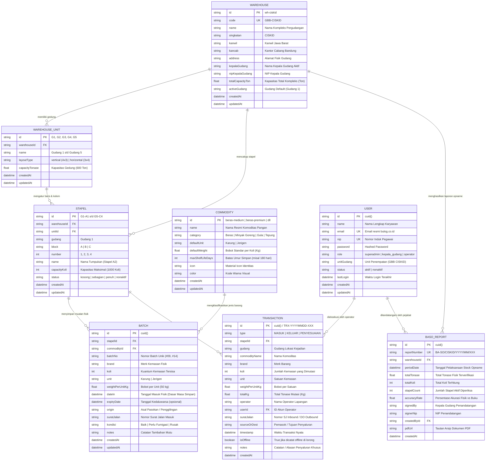

# 📊 Entity Relationship Diagram (ERD) — Database SIGAP BULOG
**Sistem Inventaris Pergudangan & Stock Opname Terpadu Perum Bulog**

Dokumen ini merangkum arsitektur basis data relasional PostgreSQL untuk sistem pergudangan SIGAP BULOG, mencakup hierarki fasilitas (Kompleks CISKID), penataan fisik stapel 4x3, pelacakan masa simpan komoditas, mutasi stok, serta dokumen resmi Berita Acara Stock Opname (BASO).

---

## 1. Visualisasi Diagram Hubungan Antar Entitas (ERD)

---

## 2. Rincian Kamus Data (Data Dictionary)

### A. Tabel `users` (Manajemen Pengguna & Hak Akses)
Tabel ini mengelola kredensial dan hak akses berbasis peran (RBAC) sesuai hierarki operasional Bulog:
- `superadmin`: Akses penuh ke seluruh kompleks gudang, menu Atur Akun, audit log, dan pengaturan sistem.
- `kepala_gudang`: Monitoring dashboard denah 2D, pelacakan masa simpan, ekspor dan pengesahan dokumen BASO.
- `operator`: Alur mobile lapangan (scan barcode/QR inbound, pencatatan penyaluran stok, pencarian tumpukan).

### B. Tabel `warehouses` & `warehouse_units` (Fasilitas Pergudangan)
- `warehouses`: Merepresentasikan kantor cabang dan kompleks pergudangan (Kompleks CISKID Bandung).
- `warehouse_units`: Merepresentasikan 5 bangunan fisik gudang di dalam kompleks CISKID (Gudang 1 hingga Gudang 5) dengan kapasitas masing-masing 600 Tonase.

### C. Tabel `stapels` (Matriks Tumpukan 2D)
Menyimpan posisi geometris 4x3 pada setiap unit gedung:
- Blok A (Baris Utara / Merah Muda): Stapel A4, A3, A2, A1
- Blok B (Baris Tengah / Kuning): Stapel B4, B3, B2, B1
- Blok C (Baris Selatan / Hijau): Stapel C4, C3, C2, C1
- Kapasitas standar: 1.000 Koli per stapel (Total 4.000 Koli per blok atau 12.000 Koli per gedung).

### D. Tabel `commodities` & `batches` (Komoditas & Umur Simpan)
- `commodities`: Master jenis pangan strategis Perum Bulog (Beras Medium SPHP CBP, Beras Premium Kita, Minyakita 5L, Gula Manis Kita, Terigu Kita).
- `batches`: Menyimpan detail setiap lot kedatangan barang. Field `dateIn` adalah kunci utama untuk menghitung **Masa Simpan (Aging Days)**:
  - `0 - 89 hari`: Status **Optimal** (Hijau)
  - `90 - 149 hari`: Status **Perlu Monitoring** (Kuning)
  - `150 - 180 hari`: Status **Prioritas Salur** (Oranye - Wajib didahulukan pengeluarannya)
  - `> 180 hari`: Status **Melewati Batas Simpan** (Merah - Perlu uji mutu laboratorium/fumigasi)

### E. Tabel `transactions` (Log Mutasi & Audit Trail)
Mencatat seluruh arus pergerakan barang secara detail:
- Tipe `MASUK`: Penerimaan dari pemasok/mitra penggilingan Karawang, Subang, dll.
- Tipe `KELUAR`: Penyaluran untuk Operasi Pasar, Bantuan Pangan, atau Delivery Order (DO).
- Menyimpan flag `isOffline` untuk mendeteksi transaksi yang dicatat saat operator berada di lorong gudang tanpa sinyal WiFi/GSM.

### F. Tabel `baso_reports` (Berita Acara Stock Opname)
Menyimpan arsip formal berita acara pemeriksaan fisik periodik yang ditandatangani oleh Kepala Gudang dan Tim Pemeriksa Fisik.

---

## 3. Strategi Indexing & Performa Query (PostgreSQL)

Untuk menjamin performa cepat pada jutaan baris mutasi stok Bulog:
1. `CREATE INDEX idx_batches_datein ON batches(dateIn);` — Mempercepat query prioritas penyaluran stok terlama.
2. `CREATE INDEX idx_stapels_gudang_block ON stapels(gudang, block);` — Mempercepat render denah 2D 4x3 secara instan.
3. `CREATE INDEX idx_transactions_stapel_time ON transactions(stapelId, timestamp DESC);` — Mempercepat riwayat kartu stok per tumpukan.
