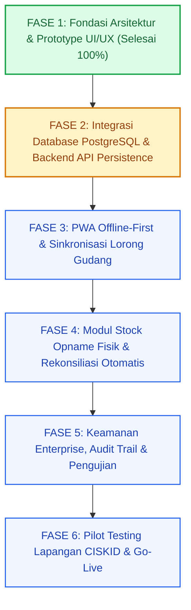

# 🗓️ Roadmap & Fase Penyelesaian Proyek SIGAP BULOG
**Sistem Inventaris Pergudangan & Stock Opname Terpadu — Perum Bulog**

Dokumen ini merinci rencana induk (*master plan*) tahapan pengembangan proyek sistem pergudangan digital **SIGAP BULOG** (studi kasus Kompleks Pergudangan Cisaranten Kidul / CISKID, Kancab Bandung). Rencana ini membagi siklus hidup proyek menjadi **6 fase berurutan dan terukur** untuk memastikan transisi mulus dari prototype interaktif menuju sistem *production enterprise* yang andal.

---

## 🧭 Ikhtisar Alur Fase Pengembangan

---

## 📌 Rincian Detail Tiap Fase

### 🟢 FASE 1: Fondasi Arsitektur, Desain UI/UX & Prototype Fungsional
**Status: SELESAI (100% Selesai)**

Fase awal difokuskan pada perancangan antarmuka pengguna (*design system*) berbasis warna korporat Bulog dan blueprint arsitektur fisik Kompleks CISKID.

#### Yang Telah Diselesaikan:
1. **Migrasi Framework Modern**:
   - Pemilihan stack **Next.js (App Router, Turbopack)** di atas runtime **Node.js** dan penghapusan menyeluruh Vite.
   - Styling terpadu dengan **Tailwind CSS v4** menggunakan palet resmi (*Bulog Navy Blue* `#1E3D73` & *Gold Grain* `#F0A516`).
2. **Denah Matriks 2D Interaktif CISKID (Gudang 1–5)**:
   - Visualisasi tata letak 4x3 tumpukan per gedung (Blok A Merah Muda, Blok B Kuning, Blok C Hijau).
   - Penempatan pintu loading dock barat dan timur.
   - Floating popover/tooltip interaktif yang menempel presisi pada kotak tumpukan dengan sistem deteksi benturan layar (*collision-aware*).
3. **Alur Mobile Operator Lapangan**:
   - Desain layar mobile ergonomis (*glove-friendly touch target* $\ge 56\text{ px}$).
   - Pindai QR/Barcode kamera untuk identifikasi stapel dan penerimaan barang (*Inbound*).
   - Layar pengeluaran barang (*Outbound*) dengan validasi umur simpan komoditas.
   - Layar detail kartu stapel dengan visualisasi meter ketinggian fisik (*Stapel Height Meter*).
4. **Otentikasi Multi-Peran & Hak Akses (RBAC)**:
   - Tiga tingkat peran: **Superadmin (Admin Pusat)**, **Kepala Gudang**, dan **Operator Lapangan**.
   - Halaman khusus **Atur Akun** yang diproteksi strictly hanya untuk Superadmin.
5. **Standarisasi Bahasa Pergudangan Bulog**:
   - Menghapus jargon "FIFO" dan menggantinya dengan istilah resmi: *Masa Simpan Komoditas*, *Prioritas Salur*, *Rekomendasi Simpan Terlama*, dan *Peringatan Urutan Pengeluaran*.
6. **Perancangan Basis Data Relasional (ERD)**:
   - Pembuatan Entity Relationship Diagram (ERD) dan skema **Prisma ORM** PostgreSQL dengan atribut alamat lengkap (*jalan, kelurahan, kecamatan, kota, provinsi, kodepos, koordinat GPS*).

---

### 🟡 FASE 2: Integrasi Database PostgreSQL & Backend API Persistence
**Status: TAHAP BERJALAN (Fokus Saat Ini)**
**Estimasi Waktu: 1 – 2 Minggu**

Tujuan fase ini adalah menggantikan penyimpanan sementara (*localStorage / state memory*) dengan database relasional **PostgreSQL** nyata agar data tersimpan permanen di server.

#### Pekerjaan yang Dilakukan:
1. **Migrasi Skema Database**:
   - Menghubungkan Prisma ORM ke layanan PostgreSQL lokal (Port 5433) atau server cloud.
   - Menjalankan migrasi awal (`npx prisma migrate dev --name init_sigap_bulog`).
2. **Seeding Master Data**:
   - Mengisi data master Kompleks CISKID (5 gedung unit, 60 titik stapel dari A1 hingga C4).
   - Mengisi data komoditas pangan pokok (Beras Medium SPHP, Beras Premium Kita, Minyakita Jerigen 5L, Gula Pasir Manis Kita, Tepung Terigu Kita).
   - Mengisi akun resmi awal (Superadmin, Kepala Gudang Hendra Wijaya, Operator Budi & Siti).
3. **Pembangunan Endpoint API Routes (Next.js)**:
   - `POST /api/auth/login` — Verifikasi kredensial NIP/Email & kata sandi dengan enkripsi `bcrypt`.
   - `GET /api/stapels` & `GET /api/stapels/[id]` — Mengambil status keterisian fisik, tonase, dan daftar batch.
   - `POST /api/inventory/inbound` — Menyimpan transaksi penerimaan barang dan menerbitkan nomor batch baru.
   - `POST /api/inventory/outbound` — Memvalidasi dan memotong stok dengan pencatatan alasan jika mendahului stok lama (*override authorization*).
   - `GET /api/reports/aging` — Mengkalkulasi otomatis batch yang mendekati batas simpan (>150 hari).
   - `GET /api/reports/baso` & `POST /api/reports/baso` — Menyimpan rekap stock opname periodik.
4. **Penyambungan Frontend ke Backend API**:
   - Refactor `WarehouseContext.jsx` agar mengambil dan memperbarui data via REST API / Server Actions secara realtime.

---

### 🔵 FASE 3: Fitur Offline-First PWA & Sinkronisasi Lorong Gudang
**Status: TAHAP BERIKUTNYA**
**Estimasi Waktu: 2 Minggu**

Gudang penyimpanan fisik sering kali mengalami kendala sinyal seluler/WiFi yang lemah di bagian lorong dalam (*dead zone*). Fase ini menjamin operator tetap dapat bekerja tanpa terputus.

#### Pekerjaan yang Dilakukan:
1. **Progressive Web App (PWA) Setup**:
   - Konfigurasi `manifest.json` resmi Perum Bulog (ikon aplikasi, nama, theme color).
   - Registrasi Service Worker untuk aset caching (*app shell*).
2. **Local Storage Engine (IndexedDB via Dexie.js)**:
   - Setiap data stapel dan komoditas dicache di perangkat mobile operator.
   - Formulir scan dan input muatan tetap dapat dibuka dan diisi meski status jaringan `OFFLINE`.
3. **Mekanisme Antrean Mutasi Offline (*Sync Queue*)**:
   - Transaksi masuk/keluar saat offline disimpan ke tabel lokal `offlineQueue` dengan stempel waktu perangkat.
   - Indikator status visual di pojok atas layar (*badge kuning "Mode Offline: X data menunggu sinkronisasi"*).
   - Auto-sync otomatis saat perangkat mendeteksi sinyal internet kembali, lengkap dengan penanganan konflik data (*conflict resolution*).
4. **Generator Cetak Label Barcode / QR Code Stapel**:
   - Modul untuk mencetak stiker barcode fisik ukuran standar untuk ditempel pada papan tumpukan/tiang stapel di lapangan (G1-A1 s/d G5-C4).

---

### 🔵 FASE 4: Modul Alur Stock Opname Terpadu & Rekonsiliasi Otomatis
**Status: PERENCANAAN**
**Estimasi Waktu: 2 Minggu**

Menerjemahkan proses inti stock opname fisik Bulog yang selama ini manual di atas kertas menjadi proses digital cepat dengan akurasi 100%.

#### Pekerjaan yang Dilakukan:
1. **Mode Pembekuan Mutasi (*Freeze Period*)**:
   - Fitur bagi Kepala Gudang untuk mengaktifkan "Sesi Stock Opname".
   - Sistem secara otomatis mengunci mutasi masuk/keluar pada gudang yang sedang dihitung agar data pembukuan tidak bergeser saat perhitungan fisik berjalan.
2. **Kalkulator Tumpukan Karung Bulog (*Tier & Layer Calculator*)**:
   - Input formulir khusus tumpukan karung beras:
     $$\text{Total Koli} = (\text{Jumlah Lapis} \times \text{Isi per Lapis}) \pm \text{Tumpukan Puncak}$$
   - Memudahkan operator menghitung cepat tanpa harus membongkar seluruh susunan tumpukan.
3. **Mesin Rekonsiliasi Otomatis (*Variance Engine*)**:
   - Membandingkan langsung hasil hitung fisik operator dengan saldo data sistem.
   - Penanda selisih instan:
     - Hijau: **Sesuai (Match)**
     - Merah: **Selisih Kurang (Shortage)**
     - Biru: **Selisih Lebih (Surplus)**
4. **Pengesahan Digital Dokumen BASO**:
   - Generator PDF resmi Berita Acara Hasil Stock Opname berstandar Perum Bulog.
   - Penyediaan QR Code verifikasi tanda tangan digital Kepala Gudang dan Tim Pemeriksa Fisik.

---

### 🔵 FASE 5: Keamanan Enterprise, Audit Trail & Pengujian Kualitas
**Status: PERENCANAAN**
**Estimasi Waktu: 1 – 2 Minggu**

Menyiapkan sistem agar memenuhi standar kepatuhan regulasi keamanan BUMN dan keandalan data.

#### Pekerjaan yang Dilakukan:
1. **Penguatan Keamanan (*Security Hardening*)**:
   - Autentikasi berbasis **JWT / HTTP-Only Secure Cookies** dengan rotasi token.
   - Middleware proteksi rute (`middleware.js`) untuk memblokir akses ilegal antar peran.
   - Proteksi serangan umum (*Rate Limiting, SQL Injection prevention via Prisma, XSS sanitization*).
2. **Pencatatan Jejak Audit Mendalam (*Comprehensive Audit Trail*)**:
   - Setiap penambahan muatan, penyaluran, perubahan status akun, dan perubahan tumpukan dicatat lengkap dengan: *User ID, Nama, Alamat IP, User Agent, dan Snapshot sebelum-sesudah*.
3. **Pengujian Kualitas Komprehensif (QA & Automated Testing)**:
   - **Unit Testing**: Pengujian logika perhitungan tonase, konversi karung/koli, dan rumus umur simpan.
   - **End-to-End (E2E) Testing**: Menggunakan Playwright untuk simulasi login, scan barcode, dan ekspor BASO.
   - **Stress Testing / Load Testing**: Pengujian ketahanan server saat puluhan operator melakukan input simultan.

---

### 🔵 FASE 6: Pilot Testing di Kompleks CISKID, Pelatihan & Go-Live
**Status: TAHAP AKHIR**
**Estimasi Waktu: 1 – 2 Minggu**

Peluncuran resmi ke lingkungan produksi lapangan di Gudang CISKID Bandung.

#### Pekerjaan yang Dilakukan:
1. **Pilot Run Lapangan (Uji Coba Terbatas)**:
   - Uji coba langsung di Gudang 1 CISKID bersama operator lapangan nyata menggunakan perangkat HP gudang.
   - Verifikasi performa kamera scanner terhadap karung beras berlabel QR Code di kondisi pencahayaan gudang sesungguhnya.
2. **UAT (User Acceptance Testing) & Sign-Off**:
   - Verifikasi kelengkapan fitur oleh Kepala Gudang dan Tim IT Kanwil Jawa Barat.
   - Penandatanganan berita acara persetujuan sistem.
3. **Pelatihan Pengguna (*User Training*) & SOP Digital**:
   - Penyusunan Buku Petunjuk Pengoperasian (User Manual) untuk Operator dan Administrator.
   - Sesi pelatihan singkat untuk petugas lapangan.
4. **Deployment Produksi & Handover**:
   - Deployment containerized via Docker ke server produksi Perum Bulog.
   - Setup backup berkala otomatis untuk database PostgreSQL.
   - Penyerahan dokumentasi teknis lengkap dan repositori kode sumber.

---

## 📊 Matriks Waktu & Deliverable Tiap Fase

| Fase | Fokus Utama | Target Deliverable | Estimasi Durasi |
| :--- | :--- | :--- | :--- |
| **Fase 1** | Fondasi Next.js, UI/UX, Denah 2D, RBAC | Prototype interaktif denah 4x3 & mobile flow | **Selesai (Done)** |
| **Fase 2** | Database PostgreSQL & API Persistence | Prisma migrate, API endpoints, sinkronisasi data nyata | 1 - 2 Minggu |
| **Fase 3** | PWA Offline-First & Label QR Stapel | PWA manifest, Dexie.js offline queue, print label stapel | 2 Minggu |
| **Fase 4** | Modul Stock Opname & BASO Digital | Freeze mode, kalkulator tumpukan, rekonsiliasi selisih | 2 Minggu |
| **Fase 5** | Security, Audit Trail & QA Testing | Proteksi JWT, audit logging, unit & E2E tests | 1 - 2 Minggu |
| **Fase 6** | Pilot Run CISKID, UAT, Deployment | UAT sign-off, pelatihan operator, deployment produksi | 1 - 2 Minggu |
